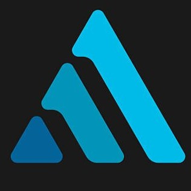

<div align="center">

  

  # Aman Jha — Personal Portfolio

  **AI & Data Science Student &bull; Machine Learning Engineer &bull; Builder**

  <p align="center">
    <a href="https://github.com/iamamanjha"></a>
    <a href="https://www.linkedin.com/in/amanjha-dev"></a>
    <a href="mailto:amanom2727@gmail.com"></a>
  </p>

  <p align="center">
    A high-performance, dark-aesthetic portfolio engineered with vanilla web technologies, dynamic ambient cursor lighting, and interactive horizontal showcase reels.
  </p>
</div>

---

## ⚡ Overview

A clean, modern portfolio presenting engineering projects, research implementations, and a comprehensive 40-technology toolkit. Built with zero bloated frontend frameworks to ensure zero runtime dependencies, instant first-contentful paint, and buttery smooth 60 FPS interactions.

### Key Highlights
- **Fluid Ambient Engine**: Real-time cursor spotlight and dynamic card sheen illumination.
- **Horizontal Project Reel**: Custom swipeable, keyboard/arrow-navigable carousel with native scroll snap.
- **Pure Native Stack**: Zero external runtime dependencies—vanilla HTML5, CSS3 variables, and ES6 JavaScript.
- **Graceful Fallbacks**: Smart dynamic SVG fallbacks for missing images or assets.

---

## 📂 Project Structure

```text
portfolio/
├── index.html        # Semantic layout & accessible structural markup
├── style.css         # Custom tokens, gradients, layouts, and animations
├── script.js        # Ambient light tracking, carousel logic & clipboard APIs
├── logo.jpg          # Brand icon (38x38 recommended)
├── profile photo.png # Profile headshot
└── README.md         # Documentation